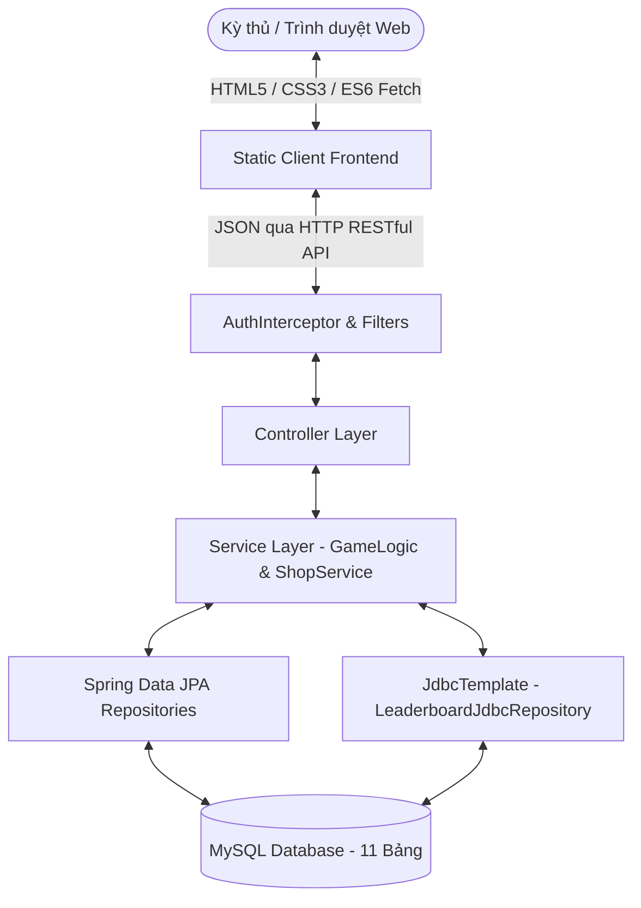
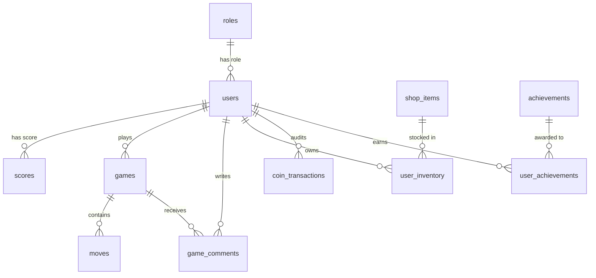

# BÁO CÁO TỔNG KẾT ĐỒ ÁN LẬP TRÌNH NÂNG CAO (JAVA SPRING BOOT & RESTFUL API)
# ĐỀ TÀI: NỀN TẢNG WEB GAME CỜ CARO CHIẾN THUẬT & HỆ SINH THÁI GAMIFICATION (GRANDMASTER ARENA)

---

## MỤC LỤC
1. [Phần 1: Tổng Quan Công Nghệ & Lý Do Lựa Chọn](#phần-1-tổng-quan-công-nghệ--lý-do-lựa-chọn)
2. [Phần 2: Sơ Đồ Cấu Trúc Thư Mục & Phân Tích Chi Tiết Từng File](#phần-2-sơ-đồ-cấu-trúc-thư-mục--phân-tích-chi-tiết-từng-file)
3. [Phần 3: Phân Tích Cơ Sở Dữ Liệu Quan Hệ (11 Bảng SQL)](#phần-3-phân-tích-cơ-sở-dữ-liệu-quan-hệ-11-bảng-sql)
4. [Phần 4: Nguyên Lý Hoạt Động & Luồng Chạy (Workflow) 8 Chức Năng Chính](#phần-4-nguyên-lý-hoạt-động--luồng-chạy-workflow-8-chức-năng-chính)
5. [Phần 5: Phân Tích Chuyên Sâu Các Đoạn Mã Nguồn & Thuật Toán Trọng Tâm](#phần-5-phân-tích-chuyên-sâu-các-đoạn-mã-nguồn--thuật-toán-trọng-tâm)
6. [Phần 6: Tiêu Chuẩn UI/UX & Thiết Kế RESTful API Theo Bài Giảng](#phần-6-tiêu-chuẩn-uiux--thiết-kế-restful-api-theo-bài-giảng)
7. [Phần 7: Bộ 10 Câu Hỏi & Câu Trả Lời Vấn Đáp Bảo Vệ Đồ Án Điểm Cao](#phần-7-bộ-10-câu-hỏi--câu-trả-lời-vấn-đáp-bảo-vệ-đồ-án-điểm-cao)

---

## PHẦN 1: TỔNG QUAN CÔNG NGHỆ & LÝ DO LỰA CHỌN

### 1.1. Kiến trúc Tổng thể (Client-Server & Multi-Layered Architecture)
Dự án được xây dựng theo mô hình **Client-Server phân tách độc lập (Decoupled Architecture)** thông qua giao thức chuẩn **RESTful API**:
- **Client (Frontend)**: Chịu trách nhiệm hiển thị giao diện, tiếp nhận hành động người dùng, bắt sự kiện và thực hiện các lời gọi HTTP bất đồng bộ (`fetch/async-await`) tới máy chủ. Frontend hoàn toàn không chứa nghiệp vụ quyết định thắng thua hay xử lý dữ liệu nhạy cảm.
- **Server (Backend)**: Triển khai theo mô hình kiến trúc phân tầng kinh điển (**Layered Architecture**) của Spring Boot:
  1. **Presentation Layer (Controller)**: Tiếp nhận HTTP Request (`GET`, `POST`, `PUT`, `DELETE`), đóng gói tham số vào DTO, kích hoạt Bean Validation (`@Valid`) và chuyển giao dữ liệu xuống tầng Service.
  2. **Business Logic Layer (Service)**: Trái tim của hệ sinh thái, chứa logic trò chơi, thuật toán AI Bot, cơ chế hàng đợi FIFO, quản lý phòng thi đấu trực tuyến In-Memory, giao dịch mua bán và mở khóa danh hiệu.
  3. **Data Access Layer (Repository)**: Giao tiếp với hệ quản trị cơ sở dữ liệu qua Spring Data JPA và Spring JDBC.
  4. **Database (MySQL)**: Lưu trữ dữ liệu quan hệ bền vững (Persistent Data).



### 1.2. Lý do lựa chọn công nghệ trong đồ án

| Thành phần công nghệ | Vai trò trong hệ thống | Lý do lựa chọn chuyên môn |
| :--- | :--- | :--- |
| **Java 25 & Spring Boot 3.5.x** | Nền tảng Backend chính | Hệ sinh thái mạnh mẽ, hỗ trợ Dependency Injection (IoC), Inversion of Control, tính năng biên dịch `-parameters` giúp ánh xạ REST Request chính xác, tích hợp sẵn Tomcat Container tốc độ cao. |
| **Spring Data JPA (Hibernate)** | Tầng ORM cho nghiệp vụ CRUD | Tự động hóa ánh xạ Entity Object sang bảng quan hệ, tự động đồng bộ lược đồ với `spring.jpa.hibernate.ddl-auto=update`, hỗ trợ giao dịch khai báo `@Transactional` chống lỗi đồng thời khi mua vật phẩm. |
| **Spring JDBC (`JdbcTemplate`)** | Tầng truy vấn hiệu năng cao | Sử dụng chuyên biệt cho bảng xếp hạng (`LeaderboardJdbcRepository`). Các truy vấn tổng hợp phức tạp (`JOIN`, `ORDER BY`, `LIMIT`) được tối ưu hóa trực tiếp bằng SQL thuần, loại bỏ chi phí ánh xạ ORM nặng nề. |
| **MySQL 8.0+** | Hệ quản trị CSDL quan hệ | Độ ổn định cao, bảo đảm toàn vẹn dữ liệu thông qua các ràng buộc Khóa chính (PK), Khóa ngoại (FK) và tính chất ACID trong giao dịch tài chính (Ví Xu). |
| **Session Authentication (`HttpSession`)** | Cơ chế xác thực & phiên làm việc | Bảo mật Statefull phù hợp với ứng dụng nguyên khối vừa và nhỏ, chống tấn công XSS/CSRF tốt hơn lưu Token trần ở `localStorage`, kết hợp với `AuthInterceptor` kiểm soát truy cập phân quyền `ADMIN` / `PLAYER` chặt chẽ. |
| **Vanilla HTML5, CSS3, JavaScript (ES6+)** | Công nghệ giao diện người dùng | Không dùng framework nặng (như React/Angular) để sinh viên nắm vững bản chất cốt lõi: DOM Manipulation, CSS Grid/Flexbox, BFCache Lifecycle, Async/Await Fetch API và xử lý Form State. |
| **Chart.js** | Thư viện biểu đồ trực quan | Vẽ biểu đồ Doughnut (tỷ lệ thắng/thua/hòa) và Bar Chart (doanh thu Xu theo danh mục) mượt mà ngay trên canvas HTML5 tại Dashboard Quản trị. |

---

## PHẦN 2: SƠ ĐỒ CẤU TRÚC THƯ MỤC & PHÂN TÍCH CHI TIẾT TỪNG FILE

```
D:\caro
├── pom.xml
├── schema.sql
├── src\main\resources
│   ├── application.properties
│   └── static
│       ├── admin.html / js\admin.js
│       ├── game.html / js\game.js
│       ├── shop.html / js\shop.js
│       ├── achievements.html / js\achievements.js
│       ├── history.html / js\history.js
│       ├── leaderboard.html
│       ├── profile.html / js\profile.js
│       ├── login.html
│       ├── index.html
│       ├── css\style.css
│       └── js\common.js
└── src\main\java\com\example\caro
    ├── CaroApplication.java
    ├── config
    │   ├── AuthInterceptor.java
    │   ├── DataInitializer.java
    │   ├── NoCacheFilter.java
    │   └── WebConfig.java
    ├── controller
    │   ├── AuthController.java
    │   ├── UserController.java
    │   ├── GameController.java
    │   ├── OnlineRoomController.java
    │   ├── ShopController.java
    │   ├── AchievementController.java
    │   ├── CommentController.java
    │   ├── LeaderboardController.java
    │   └── AdminController.java
    ├── service
    │   ├── AuthService.java
    │   ├── UserService.java
    │   ├── GameService.java
    │   ├── OnlineRoomService.java
    │   ├── ShopService.java
    │   ├── RewardService.java
    │   ├── CommentService.java
    │   ├── LeaderboardService.java
    │   └── AdminService.java
    ├── bot
    │   ├── AbstractBotPlayer.java
    │   ├── EasyBotPlayer.java
    │   ├── MediumBotPlayer.java
    │   ├── HardBotPlayer.java
    │   ├── BoardState.java
    │   └── BotService.java
    ├── repository
    │   ├── RoleRepository.java
    │   ├── UserRepository.java
    │   ├── ScoreRepository.java
    │   ├── GameRepository.java
    │   ├── MoveRepository.java
    │   ├── ShopItemRepository.java
    │   ├── UserInventoryRepository.java
    │   ├── CoinTransactionRepository.java
    │   ├── AchievementRepository.java
    │   ├── UserAchievementRepository.java
    │   ├── GameCommentRepository.java
    │   └── LeaderboardJdbcRepository.java
    ├── entity
    │   ├── Role.java
    │   ├── User.java
    │   ├── Score.java
    │   ├── Game.java
    │   ├── Move.java
    │   ├── ShopItem.java
    │   ├── UserInventory.java
    │   ├── CoinTransaction.java
    │   ├── Achievement.java
    │   ├── UserAchievement.java
    │   └── GameComment.java
    ├── dto
    │   └── [Các Data Transfer Objects trao đổi dữ liệu RESTful]
    ├── exception
    │   ├── GlobalExceptionHandler.java
    │   ├── BadRequestException.java
    │   ├── UnauthorizedException.java
    │   ├── ForbiddenException.java
    │   ├── ResourceNotFoundException.java
    │   └── DuplicateResourceException.java
    ├── model
    │   └── OnlineRoom.java
    └── util
        ├── GameRules.java
        └── SessionUser.java
```

### 2.1. Phân tích chi tiết từng gói và file Backend Java

#### A. Gói Cấu hình (`config`)
1. [`WebConfig.java`](file:///d:/caro/src/main/java/com/example/caro/config/WebConfig.java):
   - **Tác dụng**: Cấu hình Spring MVC, đăng ký Interceptor chặn đường dẫn và cung cấp Bean mã hóa mật khẩu (`BCryptPasswordEncoder`).
   - **Thành phần quan trọng**: Phương thức `addInterceptors(InterceptorRegistry registry)` đăng ký `AuthInterceptor` cho các đường dẫn `/api/**`, loại trừ các API công khai `/api/auth/login`, `/api/auth/register`, `/api/rooms/{code}`.
2. [`AuthInterceptor.java`](file:///d:/caro/src/main/java/com/example/caro/config/AuthInterceptor.java):
   - **Tác dụng**: Lớp kiểm soát cổng vào máy chủ (Gatekeeper). Trước khi Controller nhận request (`preHandle`), nó kiểm tra Session của client. Nếu chưa đăng nhập, lập tức ném ra `UnauthorizedException` (HTTP 401).
3. [`NoCacheFilter.java`](file:///d:/caro/src/main/java/com/example/caro/config/NoCacheFilter.java):
   - **Tác dụng**: Gắn các HTTP Header chống bộ nhớ đệm (`Cache-Control: no-cache, no-store, must-revalidate; Pragma: no-cache; Expires: 0`) vào toàn bộ Response, ngăn chặn trình duyệt hiển thị lại trang riêng tư khi người dùng bấm nút Back (BFCache).
4. [`DataInitializer.java`](file:///d:/caro/src/main/java/com/example/caro/config/DataInitializer.java):
   - **Tác dụng**: Chạy tự động một lần khi hệ thống khởi động (`CommandLineRunner`). Khởi tạo 2 vai trò `ADMIN`, `PLAYER`; tạo tài khoản Admin mặc định (`admin` / `admin123`); tự động bù 500 Xu khởi đầu cho tài khoản cũ; và nạp 9 sản phẩm shop cùng 6 thành tựu mẫu vào CSDL.

#### B. Gói Điều khiển (`controller`)
- [`AuthController.java`](file:///d:/caro/src/main/java/com/example/caro/controller/AuthController.java): Tiếp nhận đăng ký, đăng nhập (tạo session), lấy thông tin đăng nhập hiện tại (`/api/auth/me`) và đăng xuất (`invalidate` session).
- [`GameController.java`](file:///d:/caro/src/main/java/com/example/caro/controller/GameController.java): Xử lý nước đi AI Bot (`/bot-move`), lưu ván đấu đã kết thúc (`POST /api/games`), truy vấn lịch sử ván cờ, xem lại chi tiết nước đi (`GET /api/games/{id}`) và chỉnh sửa/xóa ván đấu.
- [`OnlineRoomController.java`](file:///d:/caro/src/main/java/com/example/caro/controller/OnlineRoomController.java): Điều phối phòng thi đấu thời gian thực: Tạo phòng (`POST /api/rooms`), danh sách phòng chờ, tham gia phòng (`/join`), gửi nước cờ Online (`/move`) và truy vấn trạng thái phòng phục vụ Polling.
- [`ShopController.java`](file:///d:/caro/src/main/java/com/example/caro/controller/ShopController.java): Cung cấp danh mục vật phẩm theo bộ lọc category, thực hiện giao dịch mua vật phẩm (`/buy/{itemId}`), trang bị/gỡ trang bị (`/equip/{itemId}`), lấy danh sách skin đang kích hoạt (`/my-equipped`) và xem biến động ví xu (`/transactions`).
- [`AchievementController.java`](file:///d:/caro/src/main/java/com/example/caro/controller/AchievementController.java): Trả về danh sách huy hiệu thành tựu kèm tiến độ hoàn thành thực tế và trạng thái mở khóa của kỳ thủ.
- [`CommentController.java`](file:///d:/caro/src/main/java/com/example/caro/controller/CommentController.java): Lấy điểm đánh giá trung bình & danh sách nhận xét của ván cờ; cho phép đăng bình luận đánh giá sao 1-5.
- [`LeaderboardController.java`](file:///d:/caro/src/main/java/com/example/caro/controller/LeaderboardController.java): Trả về bảng xếp hạng Top cao thủ theo tổng số ván đã chơi.
- [`AdminController.java`](file:///d:/caro/src/main/java/com/example/caro/controller/AdminController.java): Dành riêng cho quyền `ADMIN`: Trả về dữ liệu KPI & Chart.js (`/dashboard`), thực hiện CRUD toàn diện sản phẩm shop, xem toàn bộ giao dịch hệ thống, cộng/trừ Xu người dùng, kiểm duyệt xóa bình luận và phân quyền người dùng.

#### C. Gói Nghiệp vụ (`service`)
- [`ShopService.java`](file:///d:/caro/src/main/java/com/example/caro/service/ShopService.java): Quản lý kho hàng, xử lý mua bán giao dịch an toàn với `@Transactional`, chống mua trùng vật phẩm, trừ Xu, ghi nhật ký biến động số dư và chuyển đổi trạng thái trang bị theo từng danh mục.
- [`RewardService.java`](file:///d:/caro/src/main/java/com/example/caro/service/RewardService.java): Tự động tính toán cộng Xu thưởng sau mỗi ván cờ (thắng +80 Xu, đánh bại Bot Hard / Online +120 Xu, hòa +30 Xu) và quét kiểm tra mở khóa thành tựu tự động.
- [`OnlineRoomService.java`](file:///d:/caro/src/main/java/com/example/caro/service/OnlineRoomService.java): Quản lý phòng chơi Online bằng cấu trúc `ConcurrentHashMap` Thread-safe; tự động lưu ván cờ vào Database khi kết thúc và dọn dẹp các phòng hết hạn sau 30 phút.
- [`GameService.java`](file:///d:/caro/src/main/java/com/example/caro/service/GameService.java): Thẩm định ván cờ qua `GameRules`, lưu thông tin trận đấu và chi tiết từng nước cờ vào bảng `games` và `moves`, cập nhật điểm số `scores` và kích hoạt thưởng `RewardService`.
- [`AdminService.java`](file:///d:/caro/src/main/java/com/example/caro/service/AdminService.java): Tổng hợp số liệu thống kê cho Dashboard, quản lý danh mục sản phẩm, can thiệp điều chỉnh số dư tài khoản người dùng và xóa bình luận vi phạm.

#### D. Gói AI Bot Đấu Trí (`bot`)
- [`AbstractBotPlayer.java`](file:///d:/caro/src/main/java/com/example/caro/bot/AbstractBotPlayer.java): Lớp cơ sở trừu tượng đại diện cho người chơi máy.
- [`EasyBotPlayer.java`](file:///d:/caro/src/main/java/com/example/caro/bot/EasyBotPlayer.java): Máy cấp độ Dễ, ưu tiên đánh ngẫu nhiên vào các ô trống hợp lệ.
- [`MediumBotPlayer.java`](file:///d:/caro/src/main/java/com/example/caro/bot/MediumBotPlayer.java): Máy cấp độ Vừa, biết tìm nước đi thắng ngay và biết chặn nước thắng của người chơi.
- [`HardBotPlayer.java`](file:///d:/caro/src/main/java/com/example/caro/bot/HardBotPlayer.java): Máy cấp độ Cao Thủ (Hard), triển khai thuật toán **Minimax kết hợp Alpha-Beta Pruning** với hàm đánh giá trọng số ma trận bàn cờ cho các bàn lớn.
- [`BoardState.java`](file:///d:/caro/src/main/java/com/example/caro/bot/BoardState.java): Đối tượng đóng gói trạng thái bàn cờ, mô phỏng nước đi và kiểm tra điều kiện thắng trong không gian tìm kiếm cây trò chơi của AI.
- [`BotService.java`](file:///d:/caro/src/main/java/com/example/caro/bot/BotService.java): Factory & Dispatcher, tiếp nhận request và gọi Bot tương ứng qua tính Đa hình (Polymorphism).

#### E. Gói Hỗ trợ & Xử lý lỗi (`util`, `exception`)
- [`GameRules.java`](file:///d:/caro/src/main/java/com/example/caro/util/GameRules.java): Thư viện tĩnh chứa luật cờ Caro đa kích thước (3x3 cần 3 quân, 5x5 cần 4 quân, 10x10 cần 5 quân) và luật **Cờ Caro Vô Tận FIFO** sử dụng cấu trúc `ArrayDeque`.
- [`GlobalExceptionHandler.java`](file:///d:/caro/src/main/java/com/example/caro/exception/GlobalExceptionHandler.java): Bắt tập trung mọi lỗi phát sinh từ Controller (`@RestControllerAdvice`), định dạng chuẩn JSON thông báo lỗi chuyên nghiệp cho Client.

---

## PHẦN 3: PHÂN TÍCH CƠ SỞ DỮ LIỆU QUAN HỆ (11 BẢNG SQL)

Cơ sở dữ liệu của đồ án gồm **11 bảng** được chuẩn hóa ở dạng chuẩn 3 (3NF), chia thành 4 phân hệ chính:



### 3.1. Bảng phân hệ Người dùng & Phân quyền
1. **`roles`**: Quản lý nhóm quyền truy cập.
   - `id` (BIGINT, PK, Auto Increment): Mã định danh vai trò.
   - `name` (VARCHAR(50), UNIQUE, NOT NULL): Tên vai trò (`ADMIN`, `PLAYER`).
2. **`users`**: Lưu trữ thông tin tài khoản và số dư ví.
   - `id` (BIGINT, PK): Mã người dùng.
   - `username` (VARCHAR(50), UNIQUE, NOT NULL): Tên đăng nhập.
   - `password_hash` (VARCHAR(255), NOT NULL): Mật khẩu băm an toàn qua thuật toán BCrypt.
   - `full_name` (VARCHAR(100)): Họ tên hiển thị của kỳ thủ.
   - `role_id` (BIGINT, FK $\rightarrow$ `roles.id`): Phân quyền tài khoản.
   - `coins` (INT, DEFAULT 500): Số dư Ví Xu đấu trường.
   - `created_at` (TIMESTAMP): Thời điểm khởi tạo tài khoản.

### 3.2. Bảng phân hệ Lịch sử Ván đấu & Xếp hạng
3. **`scores`**: Thống kê thành tích phục vụ xếp hạng nhanh.
   - `id` (BIGINT, PK): Mã bản ghi.
   - `user_id` (BIGINT, FK $\rightarrow$ `users.id`, UNIQUE): Liên kết 1-1 với người dùng.
   - `games_played` / `wins` / `losses` / `draws` / `points`: Các chỉ số tích lũy của người chơi.
4. **`games`**: Thông tin tổng quan các ván cờ đã lưu.
   - `id` (BIGINT, PK): Mã ván đấu.
   - `user_id` (BIGINT, FK $\rightarrow$ `users.id`): Chủ sở hữu ván cờ.
   - `player_x`, `player_o` (VARCHAR(100)): Tên hai kỳ thủ tham chiến.
   - `winner` (VARCHAR(20)): Kết quả ván cờ (`X`, `O`, `DRAW`).
   - `board_size` (INT): Kích thước bàn cờ (3, 5, 10).
   - `game_mode` (VARCHAR(20)): Chế độ chơi (`CLASSIC`, `INFINITE`).
   - `started_at`, `ended_at` (TIMESTAMP): Thời gian bắt đầu và kết thúc ván đấu.
5. **`moves`**: Chi tiết từng nước đi phục vụ tính năng Replay phát lại ván cờ.
   - `id` (BIGINT, PK): Mã nước đi.
   - `game_id` (BIGINT, FK $\rightarrow$ `games.id` ON DELETE CASCADE): Thuộc ván cờ nào.
   - `move_number` (INT): Thứ tự nước đi (1, 2, 3...).
   - `row_index`, `col_index` (INT): Tọa độ hàng và cột đặt quân trên bàn cờ.
   - `player` (VARCHAR(10)): Ký hiệu quân cờ (`X` hoặc `O`).

### 3.3. Bảng phân hệ Cửa hàng E-Commerce & Giao dịch Xu
6. **`shop_items`**: Danh mục sản phẩm làm đẹp cho bàn cờ và kỳ thủ.
   - `id` (BIGINT, PK): Mã vật phẩm.
   - `code` (VARCHAR(50), UNIQUE): Mã code định danh (`board-obsidian`, `frame-imperial`).
   - `name` (VARCHAR(100)): Tên hiển thị của sản phẩm.
   - `category` (VARCHAR(30)): Loại sản phẩm (`BOARD_THEME`, `PIECE_SKIN`, `AVATAR_FRAME`).
   - `price` (INT): Giá niêm yết bằng Xu.
   - `css_class` (VARCHAR(50)): Lớp CSS áp dụng lên giao diện khi trang bị.
   - `preview_gradient` (VARCHAR(200)): Màu nền gradient hiển thị xem trước sản phẩm.
   - `active` (BOOLEAN): Trạng thái đang mở bán hay tạm ẩn.
7. **`user_inventory`**: Kho đồ sở hữu của từng người dùng.
   - `id` (BIGINT, PK): Mã sở hữu.
   - `user_id` (BIGINT, FK $\rightarrow$ `users.id`): Người sở hữu.
   - `item_id` (BIGINT, FK $\rightarrow$ `shop_items.id`): Vật phẩm sở hữu.
   - `equipped` (BOOLEAN): Trạng thái đang kích hoạt/trang bị trên bàn cờ.
   - `purchased_at` (TIMESTAMP): Thời gian mua.
   - *(Ràng buộc Unique: Một người dùng chỉ sở hữu 1 bản sao của mỗi vật phẩm).*
8. **`coin_transactions`**: Nhật ký kiểm toán dòng tiền (Audit Ledger).
   - `id` (BIGINT, PK): Mã giao dịch.
   - `user_id` (BIGINT, FK $\rightarrow$ `users.id`): Tài khoản biến động số dư.
   - `amount` (INT): Số xu biến động (+ thưởng, - mua hàng/phạt).
   - `balance_after` (INT): Số dư ví sau khi biến động.
   - `type` (VARCHAR(30)): Loại giao dịch (`MATCH_REWARD`, `SHOP_PURCHASE`, `ADMIN_ADJUST`).
   - `description` (VARCHAR(255)): Nội dung ghi chú biến động.

### 3.4. Bảng phân hệ Thành tựu & Đánh giá ván cờ
9. **`achievements`**: Danh mục huy hiệu danh giá trong hệ thống.
   - `id` (BIGINT, PK): Mã huy hiệu.
   - `code` (VARCHAR(50), UNIQUE): Mã code (`FIRST_BLOOD`, `BOT_SLAYER`, `GRANDMASTER_50`).
   - `title`, `description` (VARCHAR): Tiêu đề và mô tả điều kiện mở khóa.
   - `condition_type` (VARCHAR(50)): Loại điều kiện (`TOTAL_WINS`, `BOT_WIN`, `ONLINE_WIN`, `SHOP_BUY`).
   - `target_value` (INT): Ngưỡng cần đạt để mở khóa danh hiệu.
   - `reward_coins` (INT): Số Xu thưởng tặng ngay khi hoàn thành.
10. **`user_achievements`**: Ghi nhận mở khóa thành tựu của kỳ thủ.
    - `id` (BIGINT, PK): Mã bản ghi.
    - `user_id` (BIGINT, FK $\rightarrow$ `users.id`): Người chơi.
    - `achievement_id` (BIGINT, FK $\rightarrow$ `achievements.id`): Huy chương đã đạt.
    - `unlocked_at` (TIMESTAMP): Thời khắc vinh danh.
11. **`game_comments`**: Hệ thống đánh giá sao và bình luận chiến thuật cho ván đấu.
    - `id` (BIGINT, PK): Mã bình luận.
    - `game_id` (BIGINT, FK $\rightarrow$ `games.id` ON DELETE CASCADE): Ván đấu được đánh giá.
    - `user_id` (BIGINT, FK $\rightarrow$ `users.id`): Người gửi nhận xét.
    - `rating` (INT): Điểm số đánh giá chất lượng (1 đến 5 sao).
    - `content` (TEXT): Nội dung phân tích nước cờ.
    - `created_at` (TIMESTAMP): Thời gian gửi bình luận.

---

## PHẦN 4: NGUYÊN LÝ HOẠT ĐỘNG & LUỒNG CHẠY (WORKFLOW) 8 CHỨC NĂNG CHÍNH

### Luồng 1: Đăng ký, Đăng nhập & Xác thực Phân quyền Session
1. **Frontend**: Tại `login.html`, người dùng nhập username/password, JavaScript lắng nghe sự kiện `submit`, thực hiện Client-side Validation (báo lỗi dưới ô nhập nếu thiếu).
2. Khi hợp lệ, gọi `POST /api/auth/login` kèm JSON body qua hàm `api()` trong `common.js`. Nút submit chuyển sang trạng thái Loading Spinner và bị disable.
3. **Backend Filter**: Yêu cầu đi qua `NoCacheFilter`, gắn các header cấm lưu cache trình duyệt.
4. **Backend Controller**: `AuthController.login()` nhận dữ liệu $\rightarrow$ chuyển tiếp tới `AuthService.login()`.
5. **Backend Service**: `AuthService` truy vấn `UserRepository` tìm người dùng theo username $\rightarrow$ đối chiếu mật khẩu băm thông qua `passwordEncoder.matches(rawPassword, hash)`. Nếu khớp, ghi thông tin `userId`, `username`, `role` vào `HttpSession`.
6. **Phân quyền với Interceptor**: Với mọi API sau đó (trừ trang đăng nhập/đăng ký), `AuthInterceptor.preHandle()` đọc `SessionUser.id(session)`. Nếu rỗng lập tức trả về `401 Unauthorized` để Frontend tự động đưa về `login.html`. Nếu truy cập các endpoint Quản trị (`/api/admin/**`), hàm `SessionUser.requireAdmin(session)` sẽ ném lỗi `403 Forbidden` nếu role khác `ADMIN`.

### Luồng 2: Cơ chế Cờ Caro Vô Tận (FIFO Queue) & Đa kích thước bàn cờ
1. **Frontend**: Trên `game.html`, người dùng chuyển đổi kích thước bàn cờ (3x3, 5x5, 10x10) và chọn chế độ "Vô Tận (Tối đa 3 quân)". Giao diện tự động dựng lưới CSS Grid tương ứng.
2. **Cơ chế Hàng đợi FIFO**:
   - Ở bàn 3x3 Vô Tận, mỗi bên chỉ được giữ tối đa **3 quân**. JavaScript quản lý 2 mảng `queueX` và `queueO`.
   - Khi kỳ thủ đánh quân thứ 4, phần tử đầu tiên của hàng đợi (`queue.shift()`) lập tức bị xóa khỏi bàn cờ và ô đó trở lại thành ô trống. Quân cờ cũ nhất thứ 3 được gắn class nhấp nháy `.piece-dying` cảnh báo người chơi.
3. **Thẩm định an toàn ở Backend**: Khi trận đấu kết thúc, client gửi danh sách toàn bộ nước đi lên `POST /api/games`. `GameService` gọi thuật toán độc lập `GameRules.evaluateInfinite3x3(moves)`.
4. Server dùng 2 cấu trúc hàng đợi `Deque<int[]> queueX = new ArrayDeque<>()` mô phỏng lại từng bước: Nếu độ dài $\ge 3$, gọi `pollFirst()` giải phóng ô cờ cũ trước khi cho nước mới vào. Nếu có gian lận ở Client, Server sẽ ném ngay `BadRequestException`.

### Luồng 3: Chế độ Đấu với Máy (AI Bot) Áp dụng 4 Tính chất OOP
1. **Frontend**: Khi chọn đối thủ là AI Bot (Dễ, Vừa, Cao Thủ) và người chơi X vừa đi xong nước cờ, `game.js` lập tức kích hoạt `triggerBotMove()`.
2. Trình duyệt gửi `POST /api/games/bot-move` kèm danh sách nước đi hiện tại và cấp độ mong muốn.
3. **Backend Service**: `BotService.getNextMove()` tái hiện lại bàn cờ vào đối tượng `BoardState`.
4. **Áp dụng Đa hình (Polymorphism) & Trừu tượng (Abstraction)**:
   - `BotService` khai báo biến kiểu lớp cha `AbstractBotPlayer bot = getBotByDifficulty(level)`.
   - Đối tượng cụ thể được sinh ra có thể là `EasyBotPlayer`, `MediumBotPlayer`, hoặc `HardBotPlayer`.
   - Lệnh gọi duy nhất: `bot.calculateNextMove(state, 'O')`. Tùy thuộc vào instance cụ thể mà thuật toán tương ứng được kích hoạt.
5. **Thuật toán Minimax ở HardBotPlayer**: Đệ quy tìm kiếm mọi nhánh nước đi có thể, áp dụng tỉa nhánh Alpha-Beta (`alpha >= beta`) để bỏ qua các nhánh nhánh nước đi không tối ưu, tìm ra nước cờ hoàn hảo nhất để chặn người chơi hoặc tấn công kết liễu trận đấu. Nước đi trả về cho Client để render quân O lên bàn cờ.

### Luồng 4: Chế độ Chơi Online 2 Thiết Bị (RESTful API Polling)
1. **Tạo phòng**: Kỳ thủ 1 bấm "Tạo phòng mới", gửi `POST /api/rooms` kèm kích thước và chế độ. `OnlineRoomService` sinh mã phòng ngẫu nhiên 6 ký tự (ví dụ: `CARO88`), tạo đối tượng `OnlineRoom` lưu vào bộ nhớ RAM `ConcurrentHashMap<String, OnlineRoom>` với trạng thái `WAITING`.
2. **Vào phòng**: Kỳ thủ 2 nhập mã phòng trên thiết bị khác và bấm "Vào", gửi `POST /api/rooms/{code}/join`. Server chuyển trạng thái phòng sang `PLAYING`, gán Kỳ thủ 1 là X, Kỳ thủ 2 là O.
3. **Đồng bộ thời gian thực qua Polling**:
   - Cả 2 trình duyệt thiết lập `setInterval` gọi `GET /api/rooms/{code}` đều đặn mỗi **1000ms (1 giây)**.
   - Khi một bên click đánh cờ, gửi `POST /api/rooms/{code}/move`. Server dùng cơ chế `synchronized` khóa phòng cờ, kiểm tra đúng lượt, cập nhật bàn cờ và đổi lượt đi (`currentTurn`).
   - Ở chu kỳ polling tiếp theo (tối đa 1 giây), thiết bị đối thủ nhận được danh sách nước đi mới và tự động vẽ quân cờ lên màn hình.
4. **Tự động lưu**: Khi phát hiện có người chiến thắng hoặc hòa, Server tự động gọi `GameService.save()` lưu ván đấu vào CSDL, cập nhật điểm số và chuyển trạng thái phòng sang `FINISHED`.

### Luồng 5: Hệ Thống Ví Xu, Cửa Hàng & Mở Khóa Thành Tựu
1. **Xem hàng**: Vào `shop.html`, `shop.js` gọi `GET /api/shop/items`. Server trả về 9 sản phẩm kèm thông tin đã sở hữu (`owned`) và đang trang bị (`equipped`) hay chưa.
2. **Giao dịch an toàn (`@Transactional`)**: Khi người chơi bấm "Mua ngay", gọi `POST /api/shop/buy/{itemId}`. Trong `ShopService`:
   - Kiểm tra số dư người dùng $\ge$ giá sản phẩm.
   - Trừ Xu người dùng $\rightarrow$ Thêm bản ghi vào bảng `user_inventory` $\rightarrow$ Ghi biên lai vào bảng `coin_transactions`.
   - Nếu bất kỳ bước nào gặp sự cố, `@Transactional` sẽ tự động Rollback hoàn trả lại nguyên trạng CSDL.
3. **Trang bị Skin**: Khi bấm "Trang bị", gọi `POST /api/shop/equip/{itemId}`. Server tự động tìm các vật phẩm cùng danh mục của kỳ thủ đó và đặt `equipped = false`, sau đó bật `equipped = true` cho món đồ mới chọn.
4. **Mở khóa thành tựu**: Sau giao dịch hoặc sau mỗi trận thắng, `RewardService.checkAndUnlockAchievements()` được kích hoạt. Nếu người chơi vừa hoàn thành trận thắng đầu tiên (`TOTAL_WINS >= 1`), hệ thống tự động ghi nhận vào bảng `user_achievements` và cộng ngay 50 Xu thưởng vào tài khoản kỳ thủ.

### Luồng 6: Lịch Sử Ván Đấu, Trình Phát Lại (Replay) & Bình Luận Đánh Giá
1. **Lịch sử**: Tại `history.html`, `history.js` gọi `GET /api/games`. Hiển thị bảng danh sách các trận đấu.
2. **Xem lại từng bước (Step-by-Step Replay)**:
   - Khi bấm "Xem lại", Client lấy chi tiết ván đấu kèm danh sách tọa độ các nước đi từ `GET /api/games/{id}`.
   - Giao diện mở Modal chứa bàn cờ Mini và các nút điều khiển: `Đầu tiên`, `Nước trước`, `Nước sau`, `Cuối cùng`. Người xem có thể tua tới/lui từng bước đi để phân tích sai lầm chiến thuật.
3. **Đánh giá Sao & Bình luận**:
   - Dưới bàn cờ replay, người dùng chọn điểm chất lượng (1-5 sao), nhập nhận xét và bấm gửi `POST /api/games/{id}/comments`.
   - `CommentService` lưu bình luận vào bảng `game_comments`. Giao diện nạp lại danh sách bình luận kèm Khung Avatar phát sáng vương giả của người viết nhận xét.

### Luồng 7: Bảng Xếp Hạng Tối Ưu Bằng JdbcTemplate
1. Khi vào `leaderboard.html`, hàm `loadLeaderboard()` gọi `GET /api/leaderboard`.
2. Controller gọi `LeaderboardService` $\rightarrow$ chuyển tiếp tới `LeaderboardJdbcRepository.top(limit)`.
3. Thay vì dùng Hibernate load toàn bộ Entity User và Score vào bộ nhớ Java gây tốn RAM, `LeaderboardJdbcRepository` sử dụng **`JdbcTemplate`** thực thi câu lệnh SQL trực tiếp:
   ```sql
   SELECT u.username, u.full_name, s.games_played, s.x_wins, s.o_wins, s.draws
   FROM scores s JOIN users u ON u.id = s.user_id
   WHERE s.games_played > 0
   ORDER BY s.games_played DESC, u.username ASC LIMIT ?
   ```
4. Dữ liệu được `RowMapper` ánh xạ trực tiếp sang `LeaderboardRow` DTO cực nhanh và trả về bảng xếp hạng Top cao thủ kèm huy chương Vàng, Bạc, Đồng (TOP 1, TOP 2, TOP 3).

### Luồng 8: Bảng Quản Trị Hệ Thống (Admin Dashboard)
1. Chỉ người dùng có vai trò `ADMIN` mới có thể mở `admin.html` và gọi các API bắt đầu bằng `/api/admin/**`.
2. **Tổng quan & Biểu đồ Chart.js**: `AdminController.getDashboard()` tổng hợp 4 chỉ số KPI quan trọng (Doanh thu Xu, Vật phẩm đã bán, Tổng kỳ thủ, Tổng ván đấu) và dữ liệu biểu đồ. `admin.js` dùng Chart.js vẽ 2 đồ thị trực quan: Tỷ lệ thắng/thua toàn server và Doanh thu Xu theo từng nhóm vật phẩm.
3. **Quản lý Sản phẩm Shop**: Hỗ trợ đầy đủ Form Modal thêm sản phẩm mới (`POST /api/admin/shop-items`), sửa giá/tên/màu sắc (`PUT`) và tạm ngừng kinh doanh (`DELETE`).
4. **Điều chỉnh số dư Xu kỳ thủ**: Admin có thể mở Modal chọn cộng hoặc trừ Xu người chơi bất kỳ kèm lý do nghiệp vụ (ghi trực tiếp vào nhật ký giao dịch `coin_transactions`).

---

## PHẦN 5: PHÂN TÍCH CHUYÊN SÂU CÁC ĐOẠN MÃ NGUỒN & THUẬT TOÁN TRỌNG TÂM

### 5.1. Thuật toán Hàng đợi FIFO Xóa quân trong `GameRules.java`
Đoạn code quyết định cơ chế "Cờ Caro Vô Tận":
```java
// File: src/main/java/com/example/caro/util/GameRules.java (dòng 95 - 134)
public static String evaluateInfinite3x3(List<MoveDto> moves) {
    String[][] board = new String[3][3];
    Deque<int[]> queueX = new ArrayDeque<>(); // Hàng đợi quân của X
    Deque<int[]> queueO = new ArrayDeque<>(); // Hàng đợi quân của O
    String winner = null;

    for (int i = 0; i < moves.size(); i++) {
        MoveDto m = moves.get(i);
        String expected = (i % 2 == 0) ? "X" : "O"; // Kiểm tra tính xen kẽ của lượt đi

        if (winner != null) {
            throw new BadRequestException("Có nước đi sau khi ván đã kết thúc");
        }
        if (!expected.equals(m.symbol())) {
            throw new BadRequestException("Sai lượt đi ở nước thứ " + (i + 1));
        }

        Deque<int[]> myQueue = "X".equals(expected) ? queueX : queueO;

        // ĐIỂM SÁNG: Nếu đã đủ 3 quân, xóa quân cũ nhất đánh đầu tiên (FIFO)
        if (myQueue.size() >= 3) {
            int[] removed = myQueue.pollFirst(); // Lấy và xóa phần tử đầu hàng đợi
            board[removed[0]][removed[1]] = null; // Trả ô cờ về trạng thái trống
        }

        if (board[m.row()][m.col()] != null) {
            throw new BadRequestException("Ô đã có quân ở nước thứ " + (i + 1));
        }

        board[m.row()][m.col()] = m.symbol();
        myQueue.addLast(new int[]{m.row(), m.col()}); // Thêm nước mới vào cuối hàng đợi

        winner = checkWinner(board, 3, 3); // Kiểm tra 3 quân thẳng hàng
    }
    // ...
}
```
- **Ý nghĩa chuyên môn**: Sử dụng cấu trúc dữ liệu `Deque` (Double Ended Queue) với thao tác `pollFirst()` (lấy phần tử cũ nhất ở đầu) có độ phức tạp thời gian cực nhanh $\mathcal{O}(1)$, giải quyết triệt để vấn đề hòa cờ nhàm chán của cờ Caro 3x3 truyền thống.

---

### 5.2. Tính Đa Hình & Trừu Tượng trong Thiết Kế AI Bot (`BotService.java`)
```java
// File: src/main/java/com/example/caro/bot/BotService.java (dòng 43 - 48)
// Khai báo con trỏ bằng lớp cha trừu tượng AbstractBotPlayer
AbstractBotPlayer bot = getBotByDifficulty(req.difficulty());

// Tính ĐA HÌNH (Polymorphism): Cùng một lời gọi phương thức calculateNextMove(),
// nhưng hành vi thực tế sẽ được quyết định tự động dựa trên Instance đối tượng cụ thể:
// - Nếu là EasyBotPlayer: Đi ngẫu nhiên vào ô trống
// - Nếu là MediumBotPlayer: Thuật toán Heuristic công/thủ tức thời
// - Nếu là HardBotPlayer: Thuật toán Minimax vét cạn & tỉa nhánh Alpha-Beta
return bot.calculateNextMove(state, 'O');
```
- **Ý nghĩa chuyên môn**: Tuân thủ nguyên lý thiết kế **Open/Closed Principle (SOLID)**. Khi cần bổ sung cấp độ AI mới (ví dụ `MasterBotPlayer`), lập tức tạo class con kế thừa `AbstractBotPlayer` mà hoàn toàn không cần can thiệp hay sửa đổi mã nguồn của `BotService` và `GameController`.

---

### 5.3. Xử lý Đồng Thời với `ConcurrentHashMap` trong `OnlineRoomService.java`
```java
// File: src/main/java/com/example/caro/service/OnlineRoomService.java (dòng 27 - 70)
@Service
public class OnlineRoomService {
    // Lưu trữ trạng thái phòng thi đấu Online trực tiếp trên RAM máy chủ
    private final Map<String, OnlineRoom> rooms = new ConcurrentHashMap<>();

    // Từ khóa synchronized chống Race Condition khi nhiều client cùng gửi nước đi cùng một mili giây
    public synchronized OnlineRoomResponse makeOnlineMove(String roomCode, Long userId, MoveDto move) {
        OnlineRoom room = findRoom(roomCode);
        
        // Xác thực người gửi có thuộc phòng và đúng lượt hiện tại hay không
        char expectedSymbol = room.getCurrentTurn();
        if (expectedSymbol == 'X' && !userId.equals(room.getHostUserId())) {
            throw new BadRequestException("Chưa đến lượt của bạn");
        }
        // ... Cập nhật nước cờ và đổi lượt an toàn
    }
}
```
- **Ý nghĩa chuyên môn**: Sử dụng `ConcurrentHashMap` phân đoạn khóa (Segment Locking) giúp hàng trăm trận đấu diễn ra cùng lúc trên Server mà không bị nghẽn (Lock contention) như các Collection đồng bộ cổ điển (`Hashtable` hoặc `Collections.synchronizedMap`).

---

### 5.4. Giao Dịch Toàn Vẹn ACID Khi Mua Vật Phẩm (`ShopService.java`)
```java
// File: src/main/java/com/example/caro/service/ShopService.java (dòng 59 - 100)
@Transactional // Đảm bảo toàn vẹn giao dịch ACID (All or Nothing)
public ShopItemResponse buyItem(Long userId, Long itemId) {
    // 1. Kiểm tra tồn tại
    User user = userRepository.findById(userId).orElseThrow(...);
    ShopItem item = shopItemRepository.findById(itemId).orElseThrow(...);

    // 2. Chống lỗi mua trùng lặp (Idempotent Check)
    if (userInventoryRepository.existsByUserIdAndItemId(userId, itemId)) {
        throw new BadRequestException("Bạn đã sở hữu vật phẩm này rồi");
    }

    // 3. Kiểm tra số dư tài khoản
    if (user.getCoins() < item.getPrice()) {
        throw new BadRequestException("Số dư Xu không đủ...");
    }

    // 4. Trừ Xu
    user.setCoins(user.getCoins() - item.getPrice());
    userRepository.save(user);

    // 5. Cấp vật phẩm vào kho đồ
    UserInventory inv = new UserInventory(user, item);
    userInventoryRepository.save(inv);

    // 6. Ghi nhật ký giao dịch tài chính
    CoinTransaction tx = new CoinTransaction(user, -item.getPrice(), user.getCoins(), "SHOP_PURCHASE", ...);
    coinTransactionRepository.save(tx);

    return ShopItemResponse.from(item, true, false);
}
```
- **Ý nghĩa chuyên môn**: Đảm bảo an toàn tài chính tuyệt đối. Nếu thao tác lưu kho đồ hoặc ghi nhật ký giao dịch gặp lỗi hệ thống, toàn bộ hành động trừ tiền sẽ tự động phục hồi (Rollback), bảo vệ quyền lợi cho người dùng.

---

## PHẦN 6: TIÊU CHUẨN UI/UX & THIẾT KẾ RESTFUL API THEO BÀI GIẢNG

### 6.1. Thiết kế Đủ 4 Trạng Thái Giao Diện (UI States)
Mọi trang danh sách gọi API (`history.html`, `leaderboard.html`, `shop.html`, `admin.html`) đều được chuẩn hóa 4 trạng thái hiển thị rõ rệt:
1. **Loading State**: Sử dụng hiệu ứng **Skeleton Loading** (`renderSkeletonRows`) hoặc Spinner quay mượt mà, tạo cảm giác tải dữ liệu nhanh chóng, không gây giật màn hình.
2. **Empty State**: Khi danh sách trả về rỗng, hiển thị khung minh họa trang trọng (`empty-crest`), tiêu đề và nút điều hướng gợi ý hành động tiếp theo (ví dụ: *"Bắt đầu ván mới ngay"*).
3. **Error State**: Nếu mất kết nối hoặc Server trả về lỗi 4xx/5xx, hiển thị khung thông báo lỗi kèm nút **"Thử lại (Retry)"**, cho phép người dùng kích hoạt lại hàm fetch dữ liệu mà không cần tải lại toàn bộ trang (F5).
4. **Success State**: Dữ liệu nạp đầy đủ, gắn kèm các hiệu ứng hoạt cảnh (`fade-in`).

### 6.2. Chuẩn Hóa Luồng Form 6 Bước & Cập Nhật DOM Tại Chỗ
- **Luồng Form nghiêm ngặt**:
  `Nhập dữ liệu` $\rightarrow$ `Validate Client-side (báo lỗi cụ thể dưới từng ô)` $\rightarrow$ `Disabled nút Submit & Hiển thị Spinner` $\rightarrow$ `Gọi API bất đồng bộ` $\rightarrow$ `Hiển thị Toast thông báo` $\rightarrow$ `Mở lại nút bấm`.
- **Cập nhật DOM tại chỗ (Optimistic UI / In-Place Update)**:
  - Khi xóa một ván đấu hoặc một tài khoản người dùng, hàng dữ liệu trên bảng sẽ có hiệu ứng mờ dần (`row-fade-out`) và biến mất khỏi DOM mà không cần reload toàn bộ trang.
  - Khi mua vật phẩm hoặc nhận thưởng ván đấu, huy hiệu số dư Xu trên Navbar (`#navCoinAmount`) được cập nhật số tiền mới ngay lập tức.
  - Bảng cờ tự động gắn class màu sắc của Skin (`board-theme-wood`, `piece-skin-amber`, `frame-cosmic`) ngay khi kích hoạt trang bị.

---

## PHẦN 7: BỘ 10 CÂU HỎI & CÂU TRẢ LỜI VẤN ĐÁP BẢO VỆ ĐỒ ÁN ĐIỂM CAO

#### Câu 1: Em hãy giải thích luồng xác thực và bảo mật người dùng trong dự án này?
> **Trả lời:** Hệ thống sử dụng cơ chế **Stateful Authentication dựa trên `HttpSession`**. Khi người dùng đăng nhập thành công ở `AuthController`, `AuthService` kiểm tra mật khẩu bằng `BCryptPasswordEncoder` và ghi các thông tin `userId`, `username`, `role` vào Session. Với các yêu cầu tiếp theo, `AuthInterceptor` kiểm tra phiên trước khi request đến được Controller. Nếu chưa đăng nhập, Interceptor ném `UnauthorizedException` (401). Với các trang quản trị `/api/admin/**`, hệ thống đối chiếu vai trò người dùng, nếu không phải `ADMIN` sẽ ném `ForbiddenException` (403). Mật khẩu hoàn toàn không lưu dưới dạng văn bản thô (Plain Text) trong CSDL.

#### Câu 2: Tại sao trong dự án lại vừa sử dụng Spring Data JPA vừa sử dụng JdbcTemplate?
> **Trả lời:** Đây là mô hình kết hợp tối ưu kiến trúc:
> - **Spring Data JPA** được sử dụng cho 90% các nghiệp vụ CRUD thông thường, quản lý vòng đời Entity (`User`, `Game`, `ShopItem`, `UserInventory`) và kiểm soát các giao dịch có tính toàn vẹn cao thông qua `@Transactional`.
> - **`JdbcTemplate`** được dùng riêng cho Bảng xếp hạng (`LeaderboardJdbcRepository`). Vì bảng xếp hạng cần câu lệnh `JOIN` nhiều bảng, nhóm dữ liệu, sắp xếp `ORDER BY` và giới hạn `LIMIT`, việc dùng SQL thuần qua JDBC sẽ bỏ qua chi phí chuyển đổi ORM nặng nề của Hibernate, giúp tốc độ truy vấn nhanh hơn và tiêu tốn ít RAM máy chủ hơn.

#### Câu 3: Thuật toán cờ Caro Vô Tận (Infinite Mode) được cài đặt như thế nào và chống gian lận ra sao?
> **Trả lời:** Thuật toán hoạt động theo nguyên lý **Hàng đợi FIFO (First In First Out)**: Mỗi bên chỉ được phép có tối đa 3 quân cờ trên bàn. Khi đánh quân thứ 4, quân cờ cũ nhất (đánh đầu tiên) sẽ bị xóa khỏi bàn cờ và ô đó trở lại trạng thái trống. 
> Để chống gian lận (người chơi sửa code JavaScript ở client), khi kết thúc trận đấu, danh sách nước đi được gửi về máy chủ. Lớp `GameRules.evaluateInfinite3x3()` ở Backend dùng cấu trúc `ArrayDeque` độc lập để mô phỏng lại từng nước đi từ đầu. Nếu phát hiện ô cờ đã có quân mà vẫn cố tình đánh đè lên, hoặc sai lượt đi, Server sẽ từ chối lưu và ném ra `BadRequestException`.

#### Câu 4: Em đã áp dụng 4 tính chất của Lập trình Hướng đối tượng (OOP) vào phân hệ AI Bot như thế nào?
> **Trả lời:** 
> 1. **Đóng gói (Encapsulation)**: Thể hiện ở lớp `BoardState`, giấu kín mảng bàn cờ và danh sách hàng đợi quân, chỉ cho phép tương tác qua các phương thức nghiệp vụ như `makeMove()`, `isCellEmpty()`, `checkWinner()`.
> 2. **Trừu tượng (Abstraction)**: Thể hiện ở lớp trừu tượng `AbstractBotPlayer`, khai báo phương thức trừu tượng `calculateNextMove()` bắt buộc các Bot con phải triển khai thuật toán tính toán.
> 3. **Kế thừa (Inheritance)**: Các lớp `EasyBotPlayer`, `MediumBotPlayer`, `HardBotPlayer` đều kế thừa từ `AbstractBotPlayer` và tái sử dụng các phương thức chung như `findImmediateWinningMove()`.
> 4. **Đa hình (Polymorphism)**: Trong `BotService`, con trỏ khai báo là `AbstractBotPlayer bot`, nhưng lúc chạy nó có thể trỏ tới bất kỳ đối tượng Bot con nào dựa trên tham số truyền vào mà không làm thay đổi lời gọi hàm `bot.calculateNextMove()`.

#### Câu 5: Chế độ Chơi Online 2 Thiết bị được hiện thực bằng cách nào khi không dùng WebSocket?
> **Trả lời:** Dự án sử dụng kiến trúc **RESTful API Polling kết hợp In-Memory State**:
> - Trên máy chủ, `OnlineRoomService` quản lý các phòng thi đấu bằng `ConcurrentHashMap<String, OnlineRoom>` để đảm bảo an toàn đa luồng (Thread-safe).
> - Khi vào phòng, hai trình duyệt thiết lập một vòng lặp `setInterval` định kỳ **1 giây** gửi `GET /api/rooms/{code}` để lấy thông tin ván đấu mới nhất.
> - Khi một người đi cờ, họ gửi `POST /api/rooms/{code}/move`. Phương thức này được đánh dấu `synchronized` để tránh xung đột nước đi đồng thời. Khi ván cờ phân định thắng bại, Server tự động lưu ván cờ vào Database MySQL và kết thúc vòng đời phòng chơi.

#### Câu 6: Annotation `@Transactional` trong `ShopService.buyItem()` có tác dụng gì?
> **Trả lời:** `@Transactional` đảm bảo tính chất **ACID (Atomicity - Tính nguyên tử)** cho giao dịch mua hàng. Khi mua một vật phẩm, hệ thống phải thực hiện 3 hành động: (1) Trừ số dư Xu của User, (2) Tạo bản ghi sở hữu vào bảng `user_inventory`, và (3) Ghi nhật ký vào bảng `coin_transactions`. Nếu không có `@Transactional`, giả sử bước 1 trừ tiền thành công nhưng bước 2 bị lỗi đứt kết nối CSDL, người dùng sẽ bị mất tiền oan mà không nhận được đồ. Khi có `@Transactional`, Spring Boot sẽ tự động **Rollback** hoàn tiền lại nguyên trạng nếu bất kỳ bước nào trong phương thức gặp Exception.

#### Câu 7: Dự án đã xử lý lỗi BFCache (Back-Forward Cache) của trình duyệt như thế nào?
> **Trả lời:** Dự án xử lý triệt để qua 2 lớp phòng thủ:
> 1. **Lớp Backend**: `NoCacheFilter` gắn thêm các HTTP Response Headers: `Cache-Control: no-cache, no-store, must-revalidate` và `Pragma: no-cache`, báo cho trình duyệt không được nén trang vào bộ nhớ đệm lịch sử.
> 2. **Lớp Frontend**: Trong `common.js`, hệ thống lắng nghe sự kiện `window.addEventListener('pageshow', function(event) { ... })`. Khi người dùng bấm nút Back hoặc Forward trên trình duyệt, nếu cờ `event.persisted` là `true` (trang được nạp từ cache), mã JavaScript sẽ ngay lập tức gọi API `/api/auth/me` để kiểm tra phiên. Nếu phiên đã đăng xuất, trình duyệt sẽ lập tức chuyển hướng về trang `login.html`.

#### Câu 8: Tại sao trong Spring Boot 3 Controller cần truyền tham số tường minh như `@PathVariable("id")` hoặc `@RequestParam("category")`?
> **Trả lời:** Bắt đầu từ Spring Framework 6 và Spring Boot 3.2, Spring đã lược bỏ việc suy luận tên tham số qua trình biên dịch chuẩn để tối ưu hiệu năng và an ninh. Nếu trong code chỉ viết `@PathVariable Long id` mà lúc build javac thiếu cờ `-parameters`, ứng dụng sẽ ném ngoại lệ `IllegalArgumentException: Name for argument not specified, and parameter name information not available via reflection`. Do đó, việc khai báo tường minh `@PathVariable("id")` và `@RequestParam("category")` giúp code luôn chạy ổn định trên mọi môi trường và mọi trình biên dịch Java.

#### Câu 9: Cơ chế phân quyền và kiểm duyệt dữ liệu trong trang Admin được thiết kế ra sao?
> **Trả lời:** 
> - **Phân quyền**: Được kiểm soát ở tầng Controller bằng cách gọi `SessionUser.requireAdmin(session)`. Nếu người gửi request không có role `ADMIN`, hệ thống lập tức ngắt quyền và trả về HTTP 403 Forbidden.
> - **Kiểm duyệt**: Admin có toàn quyền quản lý toàn bộ thực thể: CRUD sản phẩm Shop (bật/tắt trạng thái kinh doanh `active`), xóa tài khoản người dùng vi phạm, xóa bình luận không phù hợp (`game_comments`), xóa ván cờ lỗi, và can thiệp điều chỉnh số dư Xu (`POST /api/admin/users/{id}/coins`) có ghi chép lý do minh bạch vào sổ giao dịch `coin_transactions`.

#### Câu 10: Điểm nổi bật nhất về mặt Giao diện (UI/UX) của dự án là gì?
> **Trả lời:** Điểm nổi bật nhất là phong cách thiết kế **Artistic Grandmaster Arena**:
> 1. **Tối giản & Sang trọng**: Tuyệt đối **không sử dụng Emoji rác hay Icon vụn vặt**. Toàn bộ biểu tượng, huy hiệu đều được điêu khắc bằng hình học CSS thuần (Diamond Crest xoay 45 độ, viền quang học phát sáng, bảng màu tương phản cao Obsidian, Gold Luxury và Emerald).
> 2. **Trải nghiệm ứng dụng đơn trang (SPA-like UX)**: Mọi thao tác mua đồ, trang bị skin, xem replay, xóa ván đấu đều cập nhật DOM tại chỗ không tải lại trang.
> 3. **Hệ thống Design System nhất quán**: Bố cục Split Arena chia 2 cột khoa học ở màn hình chơi cờ, kiểm soát đầy đủ 4 trạng thái giao diện và phản hồi Toast notification sang trọng.

---
*Tài liệu được biên soạn phục vụ công tác bảo vệ đồ án chuyên ngành Công nghệ Thông tin / Kỹ thuật Phần mềm.*
